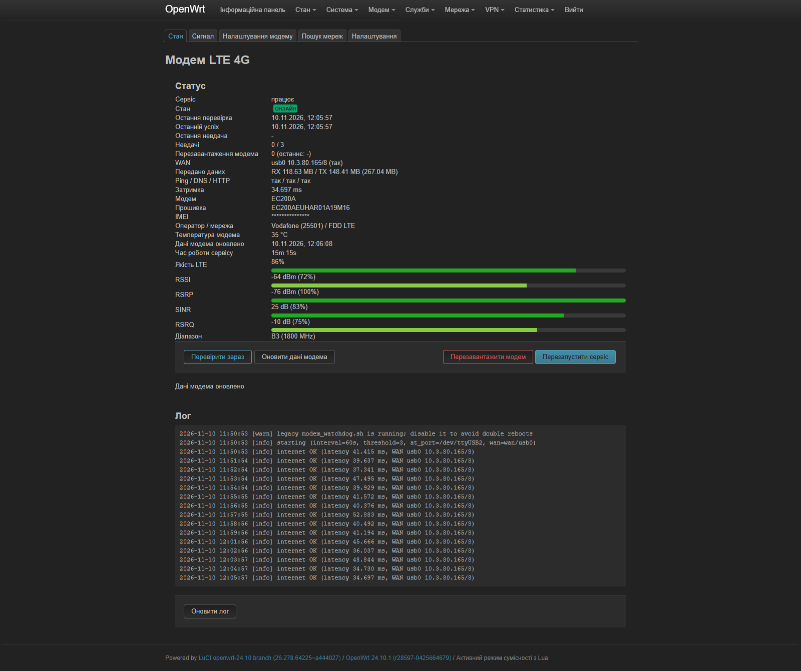
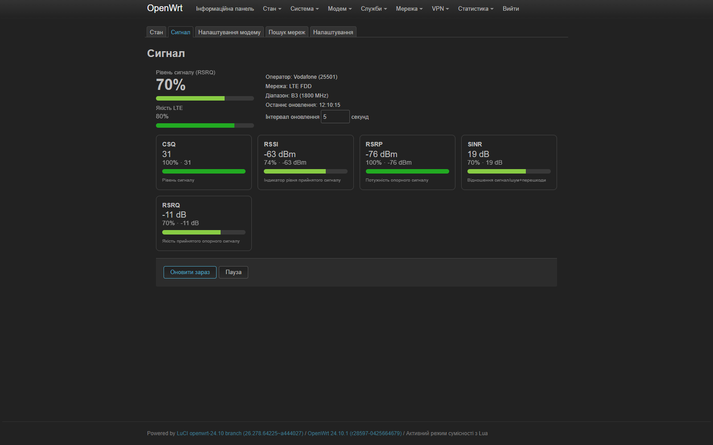
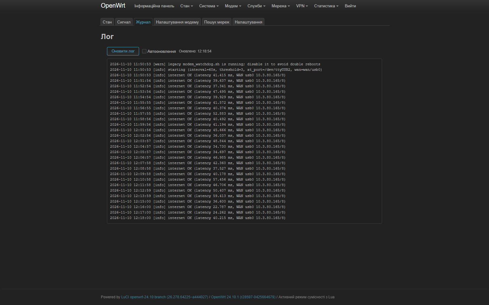
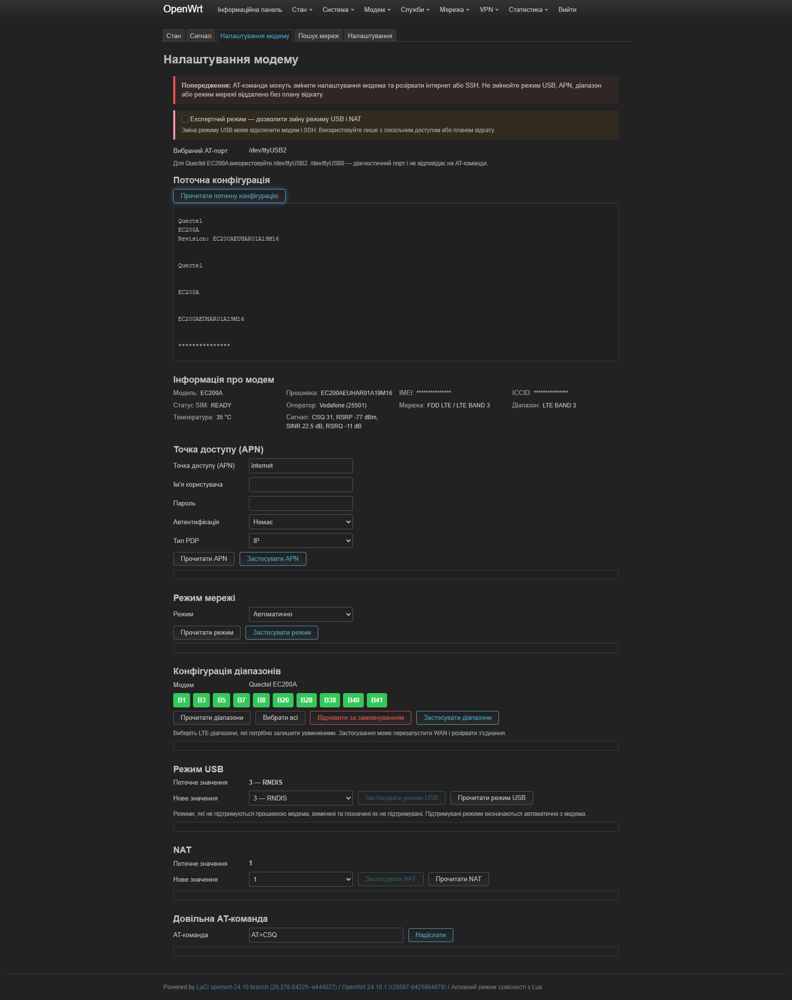
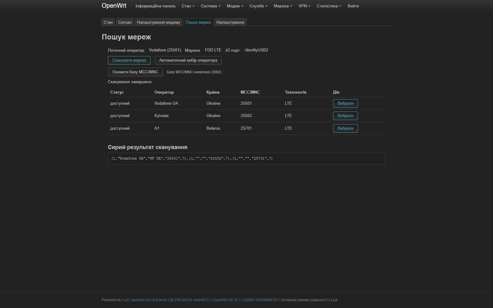
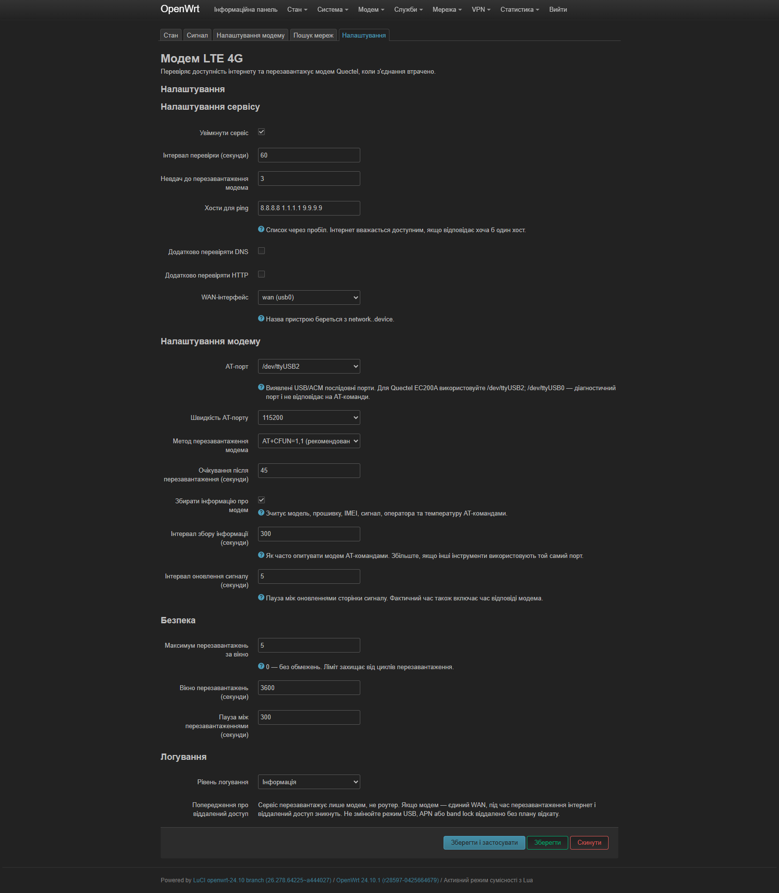

# modemwatch

Watchdog-сервіс для 4G/LTE-модемів **Quectel** на OpenWrt з веб-інтерфейсом LuCI.

Сервіс періодично перевіряє інтернет, а після заданої кількості невдалих перевірок
перезавантажує сам модем AT-командою `AT+CFUN=1,1`. Усі налаштування, статус,
логи та ручні дії доступні у LuCI.

Історія змін: [CHANGELOG.md](CHANGELOG.md).

## Можливості

- Перевірка інтернету через `ping` (кілька хостів), додатково DNS та HTTP.
- Автоматичний ребут модема після N послідовних невдач.
- Захист від циклів ребуту: cooldown, ліміт ребутів за вікно часу.
- Статус: стан, WAN IP, ping/DNS/HTTP, затримка, кількість невдач і ребутів.
- Інформація про модем: модель, прошивка, IMEI, оператор, мережа, CSQ/RSRP, температура.
- Ручні дії з веб-інтерфейсу: перевірити зараз, перезавантажити модем, перезапустити сервіс.
- Логи в syslog (`logread -e modemwatch`) і у `/var/log/modemwatch.log`.
- Окрема вкладка «Журнал» з ручним і автоматичним оновленням.
- CLI: `status`, `check`, `reboot`, `info`, `at`, `logs`.

## Скріншоти

### Статус



### Сигнал



### Журнал



### Налаштування модема



### Пошук мереж



### Налаштування сервісу



## Сумісність

Підтримувані гілки OpenWrt:

- **23.05.x** — `opkg`, `.ipk`
- **24.10.x** — `opkg`, `.ipk`
- **25.12.x** — `apk`, `.apk`

GitHub Actions збирає актуальні патчі кожної гілки:

- `23.05.6`
- `24.10.8` (пакет `all`, тому підходить і для 24.10.1)
- `25.12.6`

Snapshot-версії у матрицю не входять.

Перевірено на:

- MikroTik hAP ac3, target `ipq40xx/mikrotik`
- Quectel **EC200A** у режимі USB RNDIS
- AT-порт `/dev/ttyUSB2`
- WAN-інтерфейс `wan`, пристрій `usb0`

Код достатньо універсальний: AT-порт, швидкість, WAN-інтерфейс і метод ребуту
задаються в UCI/LuCI.

## Встановлення

### Варіант 1: готові пакети з GitHub Actions

1. Завантажте артефакт зі сторінки **Actions** вашого репозиторію.
2. Скопіюйте `.ipk` (23.05/24.10) або `.apk` (25.12) на роутер.
3. Встановіть:

Для 23.05 / 24.10 (замініть `24.10.8` на `23.05.6`, якщо потрібна 23.05):

```sh
opkg update
opkg install modemwatch_24.10.8_*.ipk luci-app-modemwatch_24.10.8_*.ipk luci-i18n-modemwatch-uk_24.10.8_*.ipk
```

Для інших мов розпакуйте `modemwatch-24.10.8-all.tar.gz` і встановіть
потрібний `luci-i18n-modemwatch-<lang>_24.10.8_*.ipk`.

Для 25.12:

```sh
apk update
apk add --allow-untrusted modemwatch_25.12.6_*.apk luci-app-modemwatch_25.12.6_*.apk luci-i18n-modemwatch-uk_25.12.6_*.apk
```

Для інших мов розпакуйте `modemwatch-25.12.6-all.tar.gz` і встановіть
потрібний `luci-i18n-modemwatch-<lang>_25.12.6_*.apk`.

Якщо пакети не підписані, для `apk` може знадобитися
`--allow-untrusted`.

Після встановлення пакет виведе список своїх залежностей. Якщо чогось
не вистачає, він покаже команду для встановлення, наприклад:

```sh
opkg update && opkg install picocom sms-tool
```

або для 25.12:

```sh
apk update && apk add picocom sms-tool
```

Якщо `picocom` ще не встановлений:

```sh
# 23.05 / 24.10
opkg install picocom

# 25.12
apk add picocom
```

4. Увімкніть і запустіть сервіс:

```sh
/etc/init.d/modemwatch enable
/etc/init.d/modemwatch start
```

### Варіант 2: збірка з SDK

На Linux-машині:

```sh
sh build.sh
```

Скрипт завантажує OpenWrt SDK 24.10.1 для `ipq40xx/mikrotik`, копіює пакети
та збирає `.ipk`. Готові файли буде видно у `bin/packages/...`.

Ручна збірка:

```sh
wget https://downloads.openwrt.org/releases/24.10.1/targets/ipq40xx/mikrotik/openwrt-sdk-24.10.1-ipq40xx-mikrotik_gcc-13.3.0_musl_eabi.Linux-x86_64.tar.zst
tar --zstd -xf openwrt-sdk-24.10.1-ipq40xx-mikrotik_gcc-13.3.0_musl_eabi.Linux-x86_64.tar.zst
cd openwrt-sdk-24.10.1-ipq40xx-mikrotik_gcc-13.3.0_musl_eabi.Linux-x86_64/
mkdir -p package/modemwatch package/luci-app-modemwatch
cp -r ../modemwatch/. package/modemwatch/
cp -r ../luci-app-modemwatch/. package/luci-app-modemwatch/
make defconfig
make package/modemwatch/compile V=s
make package/luci-app-modemwatch/compile V=s
```

### Варіант 3: як feed

Додайте репозиторій у `feeds.conf`:

```sh
src-git modemwatch https://github.com/USER/modemwatch.git
```

Потім:

```sh
./scripts/feeds update modemwatch
./scripts/feeds install -a -p modemwatch
make menuconfig
make package/modemwatch/compile V=s
make package/luci-app-modemwatch/compile V=s
```

### GitHub Actions matrix

Workflow `.github/workflows/build.yml` збирає пакети для трьох гілок:

| Версія | Формат | Архітектура пакета |
|---|---|---|
| 23.05.6 | `.ipk` | `all` |
| 24.10.8 | `.ipk` | `all` |
| 25.12.6 | `.apk` | `all` |

Кожна збірка створює пакети `luci-i18n-modemwatch-<lang>` для 41 мови
(усі доступні мови LuCI, крім російської). Артефакти мають назви
`modemwatch-<version>-all`, `luci-app-modemwatch-<version>-all`,
`luci-i18n-modemwatch-<version>-all` і `modemwatch-<version>-all-bundle`.

Оскільки обидва пакети мають `PKGARCH:=all`, достатньо однієї архітектури
SDK на версію — вміст пакета однаковий для ARM, MIPS і x86. Поле `arch`
у матриці вибирає лише SDK target, а не архітектуру готового пакета.
Залежності (`picocom`, `luci-*`) пакетний менеджер підтягне під конкретну
платформу.

Щоб додати нову версію, достатньо додати запис у `matrix.include`:

```yaml
- version: "24.10.9"
  arch: "arm_cortex-a7_neon-vfpv4"
  format: "ipk"
```

Snapshot-версії у матрицю не включені.

### Релізні файли

При пуші тегу `v*` створюється GitHub Release. Для кожної версії OpenWrt
в релізі є окремі пакети та один загальний архів:

```text
modemwatch_23.05.6_1.0.3-r1_all.ipk
luci-app-modemwatch_23.05.6_1.0.3-r1_all.ipk
luci-i18n-modemwatch-uk_23.05.6_1.0.3-r1_all.ipk
...
modemwatch-23.05.6-all.tar.gz
```

Аналогічно для `24.10.8` (`.ipk`) і `25.12.6` (`.apk`). У назві кожного
файлу явно вказана версія OpenWrt, під яку він зібраний.

Загальний архів `modemwatch-<version>-all.tar.gz` містить основний пакет,
LuCI-застосунок і всі пакети перекладів для відповідної версії.

### Переклади

Пакети перекладу доступні для 41 мови. У релізі окремо публікується
лише українська локалізація, а пакети для решти мов входять до
`modemwatch-<версія>-all.tar.gz`. Вихідні каталоги пакетів лежать
у `i18n/luci-i18n-modemwatch-<lang>`:

- `ar` — арабська
- `bg` — болгарська
- `bn` — бенгальська
- `ca` — каталонська
- `cs` — чеська
- `da` — данська
- `de` — німецька
- `el` — грецька
- `es` — іспанська
- `fa` — перська
- `fi` — фінська
- `fil` — філіппінська
- `fr` — французька
- `ga` — ірландська
- `he` — іврит
- `hi` — гінді
- `hu` — угорська
- `it` — італійська
- `ja` — японська
- `ka` — грузинська
- `ko` — корейська
- `lo` — лаоська
- `lt` — литовська
- `lv` — латиська
- `mr` — маратхі
- `ms` — малайська
- `no` — норвезька
- `nl` — нідерландська
- `pl` — польська
- `pt` — португальська
- `pt-br` — бразильська португальська
- `ro` — румунська
- `sk` — словацька
- `sv` — шведська
- `ta` — тамільська
- `tr` — турецька
- `uk` — українська
- `vi` — в'єтнамська
- `yua` — юкатецька
- `zh-cn` — китайська (спрощена)
- `zh-tw` — китайська (традиційна)

Пакет перекладу встановлюється разом з `luci-app-modemwatch` і додає мову
до списку мов LuCI. Наприклад:

```sh
opkg install luci-i18n-modemwatch-uk_24.10.8_*.ipk
```

Пакети для інших мов лежать в архіві `modemwatch-24.10.8-all.tar.gz`.

Повний перелік кодів мов — у [`scripts/languages.txt`](scripts/languages.txt).

## Веб-інтерфейс

Відкрийте LuCI за адресою роутера, наприклад:

```text
http://192.168.50.1/cgi-bin/luci/admin/modem/modemwatch
```

або через меню **Modem → Modem LTE 4G**.

Логін і пароль — ті самі, що для SSH/роутера (`root` + ваш пароль).

Пункт меню **Modem LTE 4G** відкриває **Status**. Окремі підпункти:

- **Status** — стан, статистика, інформація про модем, сигнал у відсотках
  з полосками якості та логи.
- **Signal** — швидке оновлення CSQ, RSSI, RSRP, SINR, RSRQ з відсотками
  якості та dB для налаштування антени/модема.
- **Modem settings** — поточна конфігурація, APN, режим мережі, USB-режим
  і довільна AT-команда.
- **Network search** — сканування доступних мереж, вибір оператора вручну
  або автоматично.
- **Settings** — налаштування самого watchdog-сервісу: чекбокс
  **Enable service**, інтервали, пороги, AT-порт, baud тощо.

AT-порт і WAN-інтерфейс вибираються зі списків: AT-порт — з виявлених
`/dev/ttyUSB*` та `/dev/ttyACM*`, WAN — з інтерфейсів UCI `network`.

Налаштування watchdog згруповані:

- **Service settings** — увімкнення, інтервал перевірки, поріг невдач,
  ping-хости, DNS/HTTP, WAN-інтерфейс.
- **Watchdog modem settings** — AT-порт, baud, метод ребуту, очікування після
  ребуту, збір інформації про модем, інтервал оновлення Signal.
- **Safety** — ліміт ребутів, вікно, cooldown.
- **Logging** — рівень логів.

### Вкладка Signal

Сторінка **Signal** читає вибраний AT-порт напряму, без запуску сервісу.
Показує:

- **CSQ** — індекс 0–31 і відсоток;
- **RSSI** — dBm і відсоток;
- **RSRP** — dBm і відсоток;
- **SINR** — dB і відсоток;
- **RSRQ** — dB і відсоток;
- **Signal strength (CSQ)** — головний відсоток сигналу;
- **LTE quality** — середнє RSRP/RSRQ/SINR;
- діапазон і тип мережі.

Кожен показник виводиться як `відсоток · dBm/dB`, наприклад
`100% · −76 dBm`. Інтервал оновлення задається прямо на сторінці Signal
(поле **Refresh interval**, секунди) і додатково в **Settings → Modem settings**.
Фактичний час оновлення також включає час відповіді модема.

Головний **Signal strength** береться з CSQ. **LTE quality** — це середнє
відсотків RSRP, RSRQ і SINR; воно точніше показує якість LTE для
налаштування антени. Значення можуть трохи відрізнятися від інших
інструментів, які використовують інший AT-порт і опитують модем в інший
момент.

Відсотки — це відносна шкала якості для зручності налаштування антени,
а не абсолютні лабораторні значення. Використовуються типові пороги LTE:

| Метрика | 100% | 0% |
|---|---|---|
| CSQ | 31 | 0 |
| RSSI | −50 dBm | −100 dBm |
| RSRP | ≥ −80 dBm | ≤ −120 dBm |
| SINR | ≥ 30 dB → 95% | ≤ −20 dB → 0% |
| RSRQ | ≥ −5 dB | ≤ −25 dB |

Для SINR використовується окрема шкала: `13 dB ≈ 60%`, `22 dB ≈ 75%`,
`≥ 30 dB → 95%`, `≤ −20 dB → 0%`. Тобто 100% для SINR немає — ідеального
сигналу не буває, максимум 95%.

Полоски мають **5 кольорових рівнів**:

| Відсоток | Колір |
|---|---|
| 0–20% | червоний |
| 20–40% | оранжевий |
| 40–60% | жовтий |
| 60–80% | світло-зелений |
| 80–100% | зелений |

Сторінка **Status** також показує сигнал у відсотках і dB для CSQ, RSSI,
RSRP, SINR, RSRQ, рівень сигналу (CSQ) та якість LTE.

### Modem settings

Сторінка **Modem settings** призначена для налаштування самого модема:

- **Read current configuration** — читає `ATI`, `AT+CSQ`, `AT+QCSQ`,
  `AT+COPS?`, `AT+QNWINFO`, `AT+CGDCONT?`, `AT+QICSGP=1`,
  `AT+QCFG="nwscanmode"`, `AT+QCFG="band"`, `AT+QCFG="usbnet"`,
  `AT+QCFG="nat"`, `AT+QTEMP` та інші параметри. Після читання значення
  підставляються у відповідні поля, а не лише показуються сирим текстом.
- **Modem information** — модель, прошивка, IMEI, ICCID, статус SIM,
  оператор, мережа, діапазон, температура, сигнал.
- **APN** — читає поточний APN (`AT+QICSGP=1`) за кнопкою **Read APN**
  і заповнює поля; можна змінити APN, username, password, автентифікацію
  (None/PAP/CHAP) і тип PDP (IP/IPv6/IPv4v6). Автоматичного читання при
  відкритті сторінки немає, щоб неправильний AT-порт не блокував інтерфейс.
- **Network mode** — автоматично/тільки GSM/тільки WCDMA/тільки LTE.
- **Band configuration** — зрозумілий вибір LTE-діапазонів у вигляді
  плиток `B1`, `B3`, `B7` тощо. Увімкнені діапазони читаються з
  `AT+QCFG="band"`, застосування — через `AT+QCFG="band",0,<hex>` та
  `AT&W`. Є кнопки **Select all**, **Restore default** і **Apply bands**.
- **USB mode** — читання `AT+QCFG="usbnet"` і зміна режиму (0–3) лише
  після ввімкнення **Expert mode**. Зміна USB-режиму перевстановлює
  модем у системі й може розірвати інтернет та SSH.
- **NAT** — читання `AT+QCFG="nat"` і зміна (0/1) лише в **Expert mode**.
- **Expert mode** — окремий чекбокс, який дозволяє кнопки зміни USB/NAT.
  Без нього ці параметри доступні тільки для перегляду, а зміна USB
  через Raw AT блокується.
- **Raw AT command** — довільна AT-команда з виводом відповіді.

Пакет не залежить від `3ginfo-lite`, `modemdata` або `modemband`.
Використовуються лише стандартні утиліти OpenWrt (`picocom`, `sms-tool`,
`curl`, `ca-bundle`) і власні файли пакета.

Для Quectel EC200A використовуйте AT-порт `/dev/ttyUSB2`. Порт
`/dev/ttyUSB0` — діагностичний (DM): він не відповідає на AT-команди,
а безперервно видає бінарні діагностичні логи. Якщо вибрати його,
`picocom` може зависнути й заблокувати AT-порт.

### Network search

Сторінка **Network search**:

- сканує доступні мережі командою `AT+COPS=?`;
- показує оператора, країну, MCC/MNC, технологію та статус;
- якщо модем не повернув назву оператора, підставляє її з локальної
  бази MCC/MNC;
- дозволяє вибрати оператора вручну (`AT+COPS=1,2,"MCCMNC"`) або
  автоматично (`AT+COPS=0`);
- має кнопку **Stop scan**, якщо сканування зависло;
- має кнопку **Update MCC/MNC database** для оновлення бази операторів.

База оновлюється з публічного списку, згенерованого з Wikipedia:

```text
https://github.com/pbakondy/mcc-mnc-list
```

Оновлений файл зберігається як:

```text
/usr/share/modemwatch/mccmnc.dat
```

Формат:

```text
PLMN;Country;Operator
25501;Ukraine;Vodafone
```

Пакет містить початкову копію цієї бази. Для оновлення з публічного
джерела потрібні `curl` і `ca-bundle`.

Сканування може тривати до двох хвилин і тимчасово вплинути на мобільне
з’єднання. Якщо ви підключені через цей самий модем, краще мати локальний
доступ або резервний канал.

### Документація

Для налаштувань використовуються стандартні команди Quectel EC200A:

- **Quectel EC200A Series AT Commands Manual**
- **3GPP TS 27.007** — стандартні AT-команди
- **3GPP TS 27.005** — SMS

Локальної копії PDF у репозиторії немає, але всі команди зі сторінок
є публічними та стандартними для EC200A. Для будь-якого параметра, якого
немає у формі, використовуйте **Raw AT command**.

Якщо меню не з’явилося після встановлення, зробіть hard refresh
(`Ctrl+F5`) або перезайдіть у LuCI.

### Мова інтерфейсу

Базовий пакет `luci-app-modemwatch` містить англійські рядки. Українська
мова — окремий пакет:

```text
luci-i18n-modemwatch-uk
```

Він ставиться додатково. Після встановлення виберіть українську мову в LuCI
(**System → System → Language and Style** або мовний селектор). Якщо пакет
не встановлений або вибрана англійська — інтерфейс буде англійською.

## CLI

```sh
/usr/bin/modemwatch.sh status
/usr/bin/modemwatch.sh check
/usr/bin/modemwatch.sh check --fast
/usr/bin/modemwatch.sh reboot
/usr/bin/modemwatch.sh info
/usr/bin/modemwatch.sh signal
/usr/bin/modemwatch.sh read
/usr/bin/modemwatch.sh scan
/usr/bin/modemwatch.sh scan_stop
/usr/bin/modemwatch.sh at 'AT+CSQ'
/usr/bin/modemwatch.sh logs 200
```

`check --fast` не опитує модем AT-командами, тому швидший.
`at` тепер не лише надсилає команду, а й повертає відповідь модема.

## Конфігурація UCI

Файл: `/etc/config/modemwatch`

```uci
config modemwatch 'main'
	option enabled '1'
	option at_port '/dev/ttyUSB2'
	option baud '115200'
	option check_interval '60'
	option failure_threshold '3'
	option ping_hosts '8.8.8.8 1.1.1.1 9.9.9.9'
	option dns_check '0'
	option dns_name 'openwrt.org'
	option http_check '0'
	option http_url 'http://connectivitycheck.gstatic.com/generate_204'
	option reboot_method 'cfun'
	option reboot_wait '45'
	option max_reboots '5'
	option reboot_window '3600'
	option cooldown '300'
	option collect_modem_info '1'
	option info_interval '300'
	option log_level 'info'
	option wan_iface 'wan'
```

Після зміни конфігурації:

```sh
/etc/init.d/modemwatch restart
```

## Важливо та безпека

- Сервіс перезавантажує **тільки модем**, не роутер.
- Якщо модем — єдиний WAN, під час ребуту інтернет і віддалений доступ
  зникнуть приблизно на `reboot_wait` секунд.
- Не змінюйте віддалено режим USB (`usbnet`), APN або band lock без плану
  відкату та фізичного доступу до роутера.
- **Modem settings** і **Raw AT command** можуть змінити будь-який параметр
  модема. Помилкова команда може розірвати інтернет і SSH.
- **Network search** (`AT+COPS=?`) може тривати до двох хвилин і тимчасово
  вплинути на мобільне з’єднання. Якщо сканування зависло — натисніть
  **Stop scan**.
- Вибір оператора вручну або автоматично також може тимчасово розірвати
  з’єднання.
- Якщо на роутері вже працює старий `modem_watchdog.sh`, вимкніть його,
  щоб уникнути подвійних ребутів:

```sh
ps w | grep modem_watchdog
```

- Перевірте, як він запускається (`/etc/rc.local`, cron, init-скрипт), і
  вимкніть/закоментуйте.

## Логи

```sh
logread -e modemwatch
tail -n 200 /var/log/modemwatch.log
```

`/var/log` і `/var/run` — це tmpfs, тому логи та статистика зникають після
перезавантаження роутера. Історія ребутів також зберігається в `/var/run`.

## Структура репозиторію

```text
modemwatch/
├── .github/workflows/build.yml
├── modemwatch/
│   ├── Makefile
│   └── files/
│       ├── etc/config/modemwatch
│       ├── etc/init.d/modemwatch
│       └── usr/bin/modemwatch.sh
├── luci-app-modemwatch/
│   ├── Makefile
│   ├── luasrc/
│   │   ├── controller/modemwatch.lua
│   │   ├── model/cbi/modemwatch/config.lua
│   │   ├── view/modemwatch/status.htm
│   │   ├── view/modemwatch/signal.htm
│   │   ├── view/modemwatch/modem_settings.htm
│   │   └── view/modemwatch/network_scan.htm
│   ├── po/uk/modemwatch.po
│   └── root/usr/share/rpcd/acl.d/luci-app-modemwatch.json
├── build.sh
├── README.md
└── LICENSE
```

## Ліцензія

MIT. Див. `LICENSE`.
